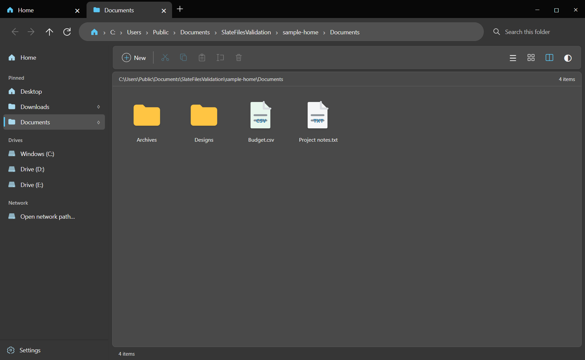

# Files

A tabbed file explorer for Windows 10/11 that works with shared files and folders — mapped network drives and UNC paths.

## Install

Download `Files-Setup-1.0.0.exe` from [Releases](../../releases) and run it. The installer is unsigned, so Windows SmartScreen may ask you to confirm.

Files is an independently built Windows file manager inspired by the general layout of Files v2. It does not include code from the official Files project. Its app icon was supplied by the user. It targets 64-bit Windows 10 and 11.

## Features

- Tabs and the requested keyboard shortcuts
- Grid and details views, optional split pane, dark and frosted glass appearances
- Local and mapped network drives, UNC paths in the address bar
- Multi-selection with Ctrl+A, Shift+click, Ctrl+click, and drag selection
- Drag and drop between folders, panes, and tabs; accepts files dropped from Windows Explorer
- New folder, rename, copy, cut, paste, open, and move to Recycle Bin

## Shortcuts

| Action | Shortcut |
| --- | --- |
| New tab | Ctrl+T |
| Restore closed tab | Ctrl+Shift+T |
| Next / previous tab | Ctrl+Tab / Ctrl+Shift+Tab |
| Select tab | Ctrl+1 through Ctrl+9 |
| Close tab / window | Ctrl+W / Ctrl+Shift+W |
| Duplicate tab | Ctrl+Shift+K |
| Select all | Ctrl+A |
| New folder | Ctrl+Shift+N |
| Copy / cut / paste | Ctrl+C / Ctrl+X / Ctrl+V |
| Rename / Recycle Bin | F2 / Delete |
| Address bar | Ctrl+L |
| Refresh | Ctrl+R |

For drag and drop inside the app, moving within a drive is the default and copying across drives is the default. Hold Ctrl to copy. Files dragged in from Explorer are copied by default. Existing names are preserved by adding a number, avoiding overwrites. The installer is unsigned, so Windows may show a SmartScreen prompt.

The installer defaults to `C:\Program Files\Files Independent` and asks for administrator access when needed. It adds Start menu and optional desktop shortcuts, and an entry in Windows Settings for uninstalling. The displayed app name is **Files**; the install folder and Settings entry say **Independent** to distinguish it from the official app.

## Build

Requires Node.js and npm on Windows. Run `npm install`, then `npm run dist`. The single-file installer is created in `dist` in this source directory. The build uses the Windows .NET Framework compiler and the locally installed Electron tools; no signing certificate is included.

## Design reference

- [Files](https://files.community/) and its [tab behavior](https://files.community/docs/features/tabs)

